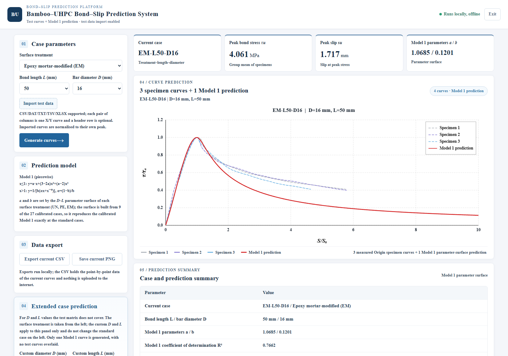

# Bamboo–UHPC Bond–Slip Prediction System

An offline, single-file prediction tool for the bond–slip behaviour of bamboo-scrimber
bars embedded in UHPC, written for the 27-case test matrix of the accompanying paper
(3 surface treatments × 3 bond lengths × 3 bar diameters).

The whole system — local web service, English interface, calibrated parameters and
27 × 5 Origin point-by-point curves — ships in **one Python file**:

```
Bamboo_UHPC_EN_single.py     (10 MB, Python 3.8+, standard library only)
```

No installation, no `pip install`, no Origin/Excel/Node/Go, no data folder, no network
access. Double-click it (or run `python Bamboo_UHPC_EN_single.py`) and the browser opens
the interface served from `127.0.0.1`.



## Quick start

```bash
python Bamboo_UHPC_EN_single.py                  # random free port, opens the browser
python Bamboo_UHPC_EN_single.py --port 53710     # fixed port (stable URL)
python Bamboo_UHPC_EN_single.py --no-browser     # serve only, print the URL
python Bamboo_UHPC_EN_single.py --export "out"   # batch CSV/XLSX/README, no GUI
```

| Option | Meaning |
|---|---|
| `--port N` | bind a fixed local port (`0` = random free port) |
| `--no-browser` | start the service without opening a browser |
| `--url-file FILE` | write the access URL to a file (with `--no-browser`) |
| `--export DIR` | write `27_cases_curve_points.csv`, `27_cases_batch_results.xlsx` and `EXPORT_README.txt`, then exit |

## What the interface does

- **Existing test conditions** — pick the surface treatment (UN / PE / EM), bond length
  *L* (50/100/150 mm) and bar diameter *D* (8/16/24 mm); the chart shows the three
  measured Origin curves of that case plus one Model 1 prediction.
  For EM-L50-D16 the header reports τu = 4.061 MPa, su = 1.717 mm, a = 1.0685,
  b = 0.1201.
- **Experimental data import** — CSV, TXT, DAT, TSV or XLSX (first worksheet); every two
  columns are one X/Y curve, each imported curve is normalised to its own peak, and the
  imported curves replace the built-in specimen curves.
- **Extended conditions** — interpolate a Model 1 curve at a custom *D*/*L* from the
  bilinear *D–L* parameter surface (outside the calibrated range the surface edge values
  are used and the GUI says so).
- **Export** — current CSV (12 columns, point by point) and a 3600 × 1980 PNG.

## Model

Model 1 of the paper (piecewise):

```
x <= 1 :  y = a·x + (3 − 2a)x² + (a − 2)x³
x >  1 :  y = 1 / [ b·(α·x + x^(−α)) ],   α = (1 − b)/b
```

where `a` and `b` come from a 3 × 3 bilinear surface per surface treatment, built from
the nine calibrated cases; at the calibrated nodes the paper values are reproduced
exactly. `x = S/Su`, `y = τ/τu`.

## Data

- 27 cases, 135 curves, **1,257,616 point-by-point samples**, exported from the Origin 9.8
  project *"Normalized fitting curves - 1216 adjustment.opju"*.
- The X/Y columns are already normalised (`S/Su`, `τ/τu`); the tool never normalises
  twice, and the "rebuilt" columns only apply `s_mm = x·su` and `τ_MPa = y·τu` for audit.
- `UN-L50-D16` is empty in the original OPJU (0 rows, empty Graph2); its three specimens
  and two models were recovered from the Origin figure embedded in the final paper DOCX
  (Figure 11(a)) by reading the numeric data set stored in that figure — not by digitising
  a screenshot.

## Exports

`--export` writes:

| File | Content |
|---|---|
| `27_cases_curve_points.csv` | 1,257,616 data rows + header, UTF-8 BOM, 12 columns, 7 decimals |
| `27_cases_batch_results.xlsx` | `Summary_27cases`, `UN_curves`, `PE_curves`, `EM_curves`, `Notes_and_formulas` |
| `EXPORT_README.txt` | English report: counts, column meanings, conventions |

CSV columns: Case ID, Surface treatment, L_mm, D_mm, Curve name, Curve type, Point,
Normalized slip S/Su, Normalized bond stress tau/tauu, Rebuilt slip_mm,
Rebuilt bond stress_MPa, Data source.

## Verification

- The CSV produced here is **byte-identical** to the one produced by the Go build of the
  same system (158,391,753 B, 1,257,617 lines,
  SHA-256 `58407A46D7D8D1FEE58FB4331E297E47CEDDC577DB8261B36478AE0D6A1A0081`).
- The XLSX has the same five worksheets and row counts
  (28 / 332,242 / 590,774 / 334,603 / 15) as the Go build.
- Runs from a folder that contains only this `.py`; also verified from a path with
  Chinese characters and spaces; startup ≈ 3.6 s (≈ 3.2 s of it is compiling the 10 MB
  source, the data load itself is 0.37 s).

## Repository layout

```
Bamboo_UHPC_EN_single.py   the complete system (service + UI + data, embedded)
docs/interface.png         screenshot of the English interface
README.md                  this file
```

## 中文快速上手

1. 安装 Python 3.8 或更高版本（安装时勾选 *Add python.exe to PATH*）。
2. 只需这一个 `Bamboo_UHPC_EN_single.py` 文件，双击或命令行运行：
   `python Bamboo_UHPC_EN_single.py`，浏览器会自动打开界面；关闭界面点右上角 **Exit**。
3. 想固定网址：`python Bamboo_UHPC_EN_single.py --port 53710`，之后访问
   `http://127.0.0.1:53710/`。
4. 只导出全部 27 组数据：`python Bamboo_UHPC_EN_single.py --export "输出目录"`，
   约 40 秒，得到 CSV + Excel + 英文报告。
5. 程序只监听本机 `127.0.0.1`，数据不出电脑；不需要联网、不需要管理员权限。

## Notes and limitations

- The service binds to `127.0.0.1` only: it is a local desktop tool, not a public server.
- The 10 MB file size is the 25 MB Origin database stored inside the script as
  zlib-compressed, base64-encoded text.
- Origin's Model 1/Model 2 arrays are authoritative; the tool does not re-fit them.
- The rational Model 2 of the paper can become negative at large slip; the plot clips to
  0–1.2 while the exported data keeps the original value.

## License

No license file is included yet. If you intend to reuse or redistribute the code, add a
license (for example MIT) with the author's agreement.
